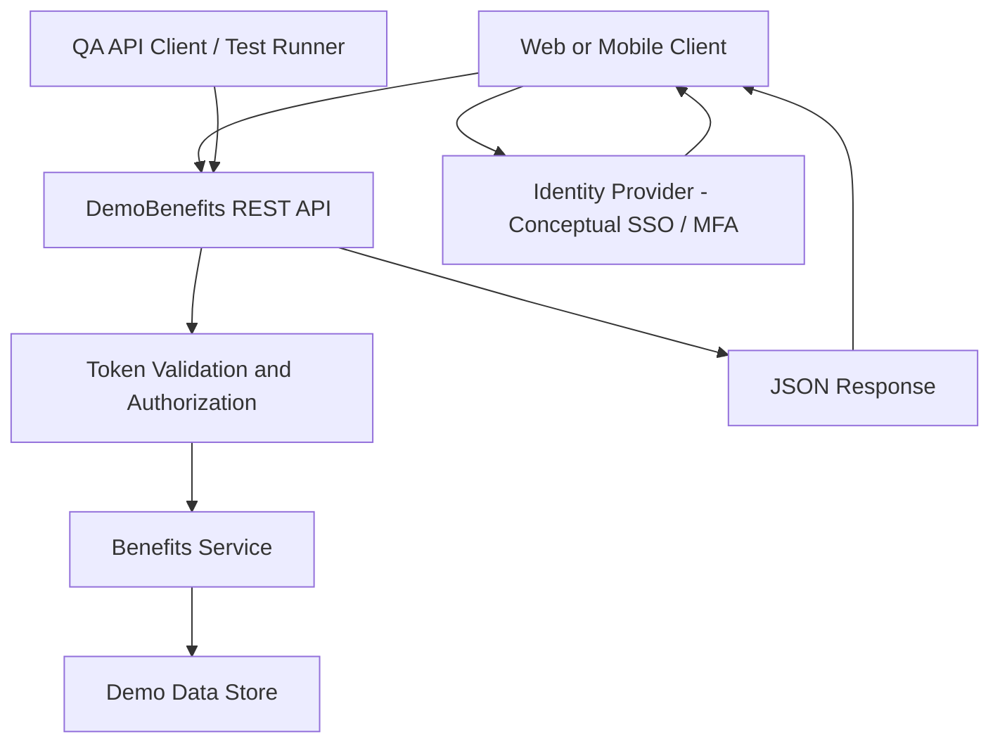

# Conceptual API and Authentication Architecture

This is a conceptual teaching diagram, **not** a depiction of AON infrastructure.

## Test boundaries
- **Authentication:** Who is the user? Session/token validity and MFA challenge states.
- **Authorization:** What resources may the authenticated user access?
- **API contract:** HTTP method, endpoint, request payload, response payload and status code.
- **Data checks:** Required fields, formats, values and sensitive-field exposure.
- **Negative testing:** Invalid parameters, missing auth, expired token, forbidden resource access, wrong OTP, excessive attempts (in an authorized environment).
