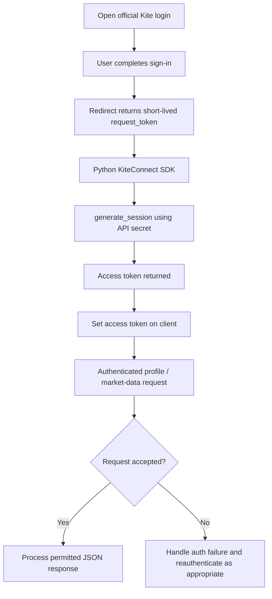

# Authentication and Token Lifecycle — Conceptual

### Key distinction
- **Generate token:** exchange `request_token` for `access_token`.
- **Validate token:** call a permitted protected endpoint (for example, profile), then inspect success/error response. This is not the same as merely verifying that a token string is nonempty.
- **Expire/revoke:** avoid assuming a token is valid just because it was previously generated.

The input screenshots demonstrate the first operation. Protected-endpoint validation is a **proposed test step**.
