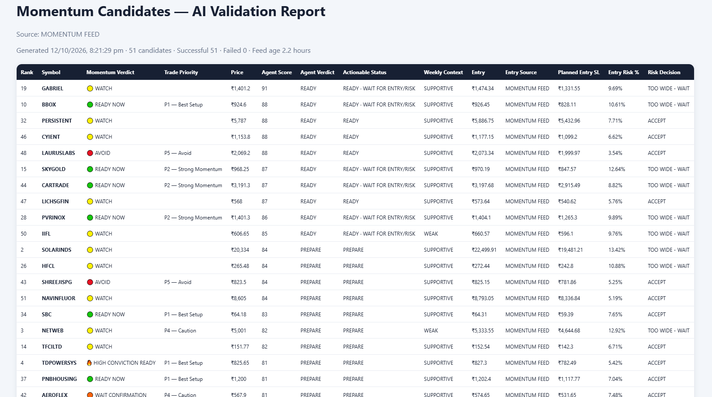
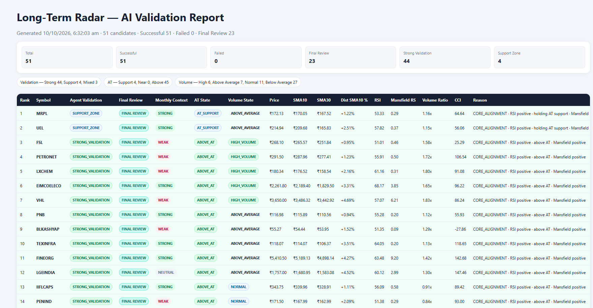

# TradingView Agent AI — Browser Automation & Reporting

> **Portfolio demonstration.** Sample inputs and outputs in this folder are synthetic illustrations, not actual market data, production logs or client material.

## Purpose
Automate a repeatable browser-based analytics validation workflow: read candidate JSON, navigate chart interfaces, extract configured indicators, normalize extracted values, evaluate predefined scoring/risk rules and present results in an HTML report.

## Technology
- JavaScript, Node.js, Playwright Test and Chromium
- JSON input/output; HTML and CSS reporting
- Test assertions, diagnostics, retries and regression checks

## Workflow
1. Export candidate records from the Python analytics application as JSON.
2. Validate candidate schema and identify symbols for processing.
3. Use Playwright to navigate charts and wait for relevant UI readiness.
4. Extract indicators, normalize values and check for missing/inconsistent data.
5. Apply domain-specific scoring and risk rules.
6. Generate a browser-readable HTML report with execution outcomes.

See [architecture](docs/architecture.md), [synthetic JSON sample](samples/candidates.synthetic.json), [demonstration report](samples/validation-report.demo.html) and [QA scenarios](docs/test-scenarios.md).

## Report Screenshots

These screenshots illustrate the reporting UI from personal analytics runs. They are **not** a substitute for reviewing the underlying implementation or for independent verification of financial data.

### Momentum Validation Report

[Open full-size momentum preview](screenshots/momentum-report-preview.png) · [View uploaded HTML source](samples/momentum-candidates-report.html)

### Long-Term Radar Validation Report

[Open full-size long-term preview](screenshots/long-term-report-preview.png) · [View uploaded HTML source](samples/long-term-validation-report.html)

> The two uploaded real-data HTML reports may contain third-party-derived market information. Public redistribution permissions should be checked before using them in interview materials. The separate `validation-report.demo.html` uses synthetic data.

## Demonstration boundaries
The HTML report is **illustrative** and is not linked to a runnable TradingView automation in this public portfolio. It shows the *format and kinds of checks* used in the private personal project. No live trading signal, investment recommendation or guaranteed performance is implied.

## Interview talking points
- Data-driven browser automation with structured input
- Synchronization with dynamic UI and resilient selectors
- Parsing, normalization, error handling and validation
- Report generation, independent risk decisions and regression testing
