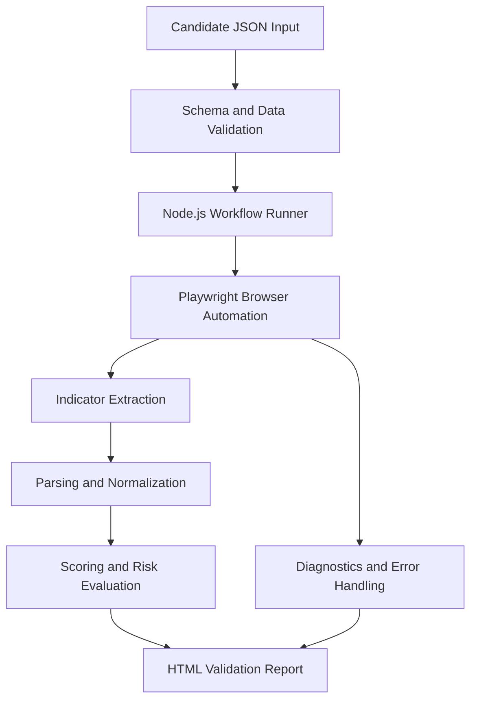

# Workflow Architecture (Conceptual)

## Component responsibilities
| Component | Role |
| --- | --- |
| JSON input | Data-driven list of symbols and candidate metadata |
| Node.js runner | Processes the candidate feed and coordinates runs |
| Playwright | Interacts with browser UI and extracts displayed data |
| Normalization | Converts UI labels and numeric strings into consistent types |
| Validation | Detects incomplete extraction and checks eligibility |
| Reporting | Summarizes input, classifications, entry/risk fields and execution status |

**Note:** Simplified, illustrative architecture for interview discussion; not a full source-code diagram.
