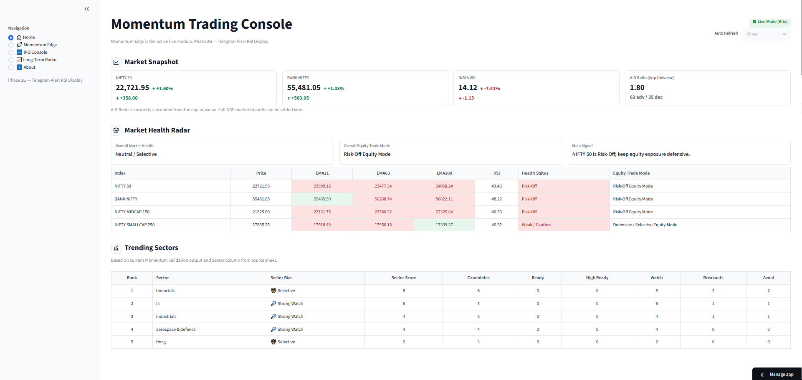

# Momentum Edge — Python & Streamlit Analytics Application

> **Personal project case study.** This module describes architecture and QA-relevant engineering concepts. It does not contain actual brokerage credentials, positions, private inputs, proprietary market feeds or live recommendations.

## Project overview
Momentum Edge is a Python-based, interactive stock analytics and decision-support application. Its purpose is to load candidate data, validate data completeness and freshness, apply predefined eligibility/technical/risk rules, rank candidates and display clear statuses for review.

**Technology:** Python, Pandas, Streamlit, Excel/CSV/JSON, integrations with permitted market-data APIs, Git/GitHub. AI coding assistance was used during development, with functional review and regression testing.

## Core modules
| Module | Purpose |
| --- | --- |
| Home | Summary metrics and market overview |
| Market Breadth | Market participation and breadth assessment |
| Momentum Edge | Swing candidate filtering, ranking and decisions |
| IPO Console | Recently listed equity screening and validation |
| Short-Term Radar | Intraday/next-session setup analysis |
| Long-Term Radar | Weekly trend and long-term candidate review |

## Data processing workflow
1. Load selected candidate workbooks/JSON exports and approved data integrations.
2. Validate schema, required fields, timestamps and input completeness.
3. Prepare tables using Python/Pandas and apply business rules.
4. Produce ranking, classifications, risk fields and actionable statuses.
5. Render interactive Streamlit filters, metrics and tables.
6. Export selected structured results for downstream browser automation.
7. Report unavailable, partial and stale data rather than presenting it as current.

[Architecture diagram](docs/architecture.md) · [Features](docs/module-catalog.md) · [QA scenarios](docs/qa-validation-checklist.md)

## Technical contributions and interview relevance
- **Data engineering:** tabular file ingestion, normalization, validation, filtering and ranking.
- **Python logic:** reusable calculations and deterministic classification rules.
- **Dashboard UI:** interactive filters, metrics and data tables.
- **Reliability:** source freshness, snapshot fallback and clearly disclosed partial data.
- **Integration:** JSON handoff to a separate Playwright/Node.js Agent AI validation workflow.
- **QA approach:** input, business-rule, output and regression checks.

## Project status
The original Streamlit application has been published separately in its application repository. Modules and displayed data depend on feed/market availability. The new Next.js/FastAPI website is a distinct **local migration project** covered under [04-fullstack-website](../04-fullstack-website/).

## Home Dashboard Preview

[Open the Home dashboard screenshot](screenshots/home-dashboard.png)

This screenshot demonstrates the application's interface. Review the original image for sensitive account or market data before distributing it more widely. This public case study is **documentation**, not a runnable copy of the underlying application.

## Security and limitations
The described financial analytics are decision-support tools, not guaranteed investment results or advice. No live credentials, order automation, personal holdings or unauthorized market data are published here.
