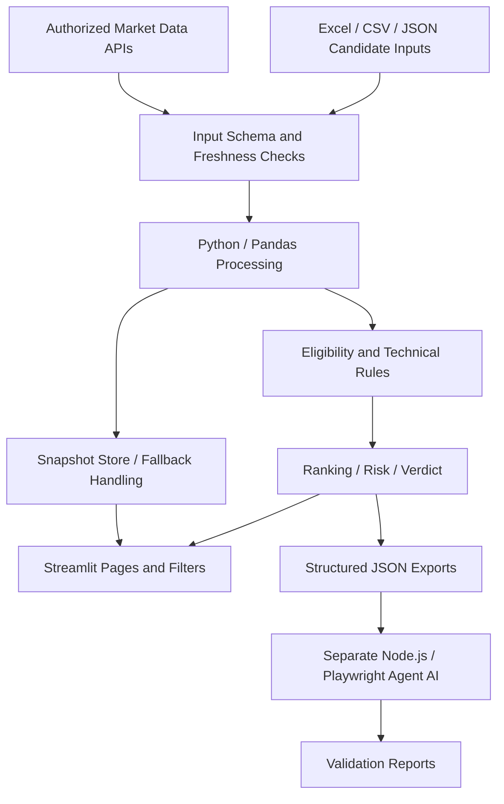

# Momentum Edge — Conceptual Architecture

Conceptual presentation of the personal project, not a line-by-line source map. Integrations may be unavailable or stale depending on data source and session.

## Distinct responsibilities
- **Python/Pandas:** ingestion, transformation, indicator-derived features and decisions.
- **Streamlit:** interactive presentation, controls and tables.
- **Market data integration:** authorized access, response checks and freshness.
- **Agent AI:** separate JavaScript/Playwright workflow; not a Streamlit component.
