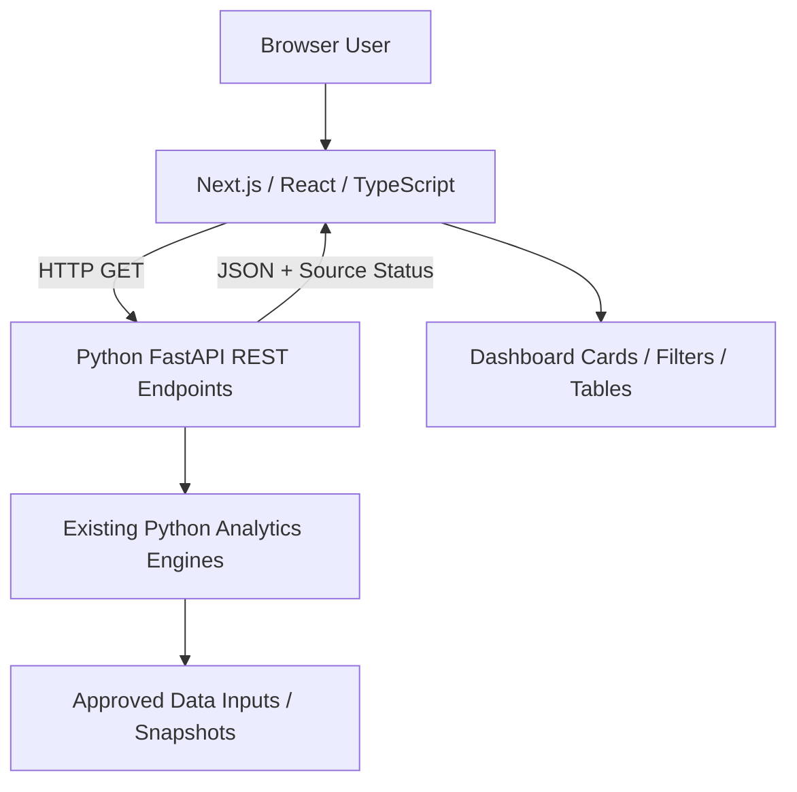

# Momentum Edge Website — Next.js / FastAPI Migration

> **Local-development case study.** This is documentation about an AI-assisted personal full-stack migration. The new website is **not represented as publicly deployed** and this folder does not contain full source code.

## Objective
Replace the Streamlit presentation layer with a dedicated Next.js website while retaining the existing Python analysis engines and decision rules. The frontend communicates with a FastAPI backend through JSON REST endpoints.

## Technology stack
- **Frontend:** Next.js, React, TypeScript, HTML/CSS
- **Backend:** Python, FastAPI, JSON REST APIs
- **Quality:** TypeScript checking, ESLint, frontend build validation, backend regression tests, browser checks
- **Developer workflow:** Git/GitHub, VS Code, AI-assisted development and review

## Architecture

[Detailed architecture](docs/architecture.md) · [API contract](docs/api-contract.md) · [Validation summary](docs/validation-and-status.md)

## Implemented page routes
`/` (Home), `/market-breadth`, `/momentum`, `/ipo`, `/short-term`, `/long-term`.

## Backend endpoint catalog
| Endpoint | Function |
| --- | --- |
| `GET /api/health` | API health |
| `GET /api/home` | Home metrics |
| `GET /api/market-breadth` | Market Breadth results |
| `GET /api/momentum` | Momentum candidates |
| `GET /api/ipo` | IPO analytics |
| `GET /api/short-term` | Short-Term Radar |
| `GET /api/long-term` | Long-Term Radar |

## Implementation highlights
- Reusable page shell with navigation and shared API health indicator.
- Data retrieval and table/filter rendering across six frontend routes.
- Separate source freshness/completeness indicators to avoid misrepresenting older snapshots as live data.
- Existing Python decision logic retained rather than independently rewritten in frontend.
- Browser, build, type, lint and backend tests reported during migration phases.

## Validation and accuracy
Prior project-stage reports recorded successful build, strict TypeScript, lint, backend and agent regression tests. One phase reported 83 backend regression tests. These were **historical project-stage results**, not tests freshly rerun for this portfolio document.

**Status:** Local application development. Some modules were observed with stale or partial source data in early October 2026. Live market-data integration depends on valid credentials and permitted source access.

## Next portfolio evidence
Sanitized frontend screenshots, sample endpoint response schemas and a short local demo video can be added after review. Never upload Kite credentials, private data or internal environment details.
