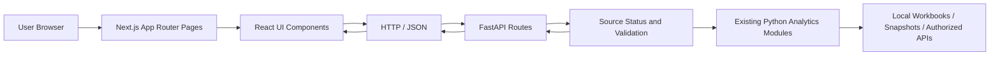

# Full-Stack Architecture and Migration Boundaries

## Frontend
- App Router based page navigation and reusable sidebar/topbar shell.
- React components render KPI cards, filters, statuses and tables.
- UI distinguishes loading, error, partial and stale results where supported.

## Backend
- FastAPI routes expose the underlying Python analytics outputs.
- JSON responses carry candidate data plus provenance/state information.
- Health endpoint separates server responsiveness from availability of market feeds.

## Migration principles
1. Preserve approved business calculations and classification semantics.
2. Move presentation from Streamlit to Next.js without inventing source records.
3. Validate complete inputs before marking a feed current.
4. Test backend contracts and frontend page behavior independently.
5. Keep public portfolio material separate from the actual application's credentials and private data.
