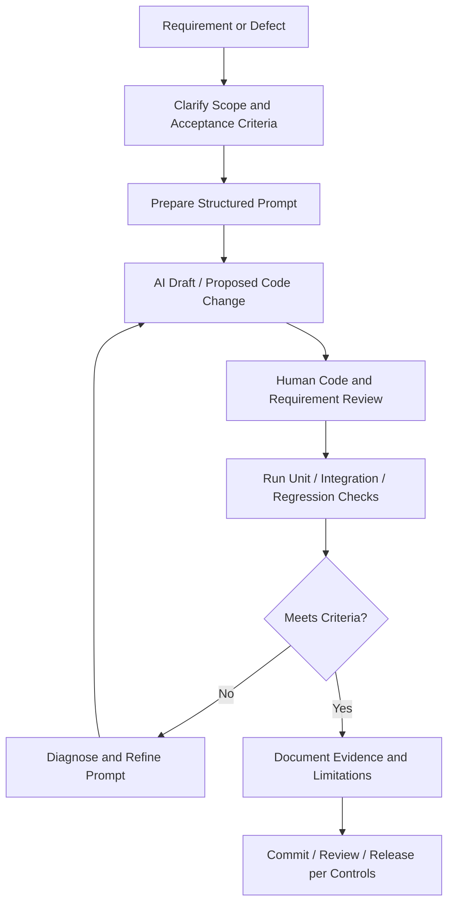

# AI-Assisted Engineering Workflow

## How tools fit
- **ChatGPT:** planning, explanation, design alternatives, QA questions and prompt drafting.
- **Copilot:** assisted drafting of use cases, scenarios, cases and RTM entries using approved stories.
- **Codex:** codebase inspection, scoped implementation, debugging and permitted test execution.
- **GitHub Actions:** independently executes configured automated checks after code is pushed.

## Example from personal work
For browser extraction issues, isolate the failing stock/indicator, provide a reproducible symptom, request limited parser changes, then run targeted and regression tests. Preserve existing scoring and templates unless explicitly approved.

Historical project examples are summarized here; this public module does not publish original private transcripts.
